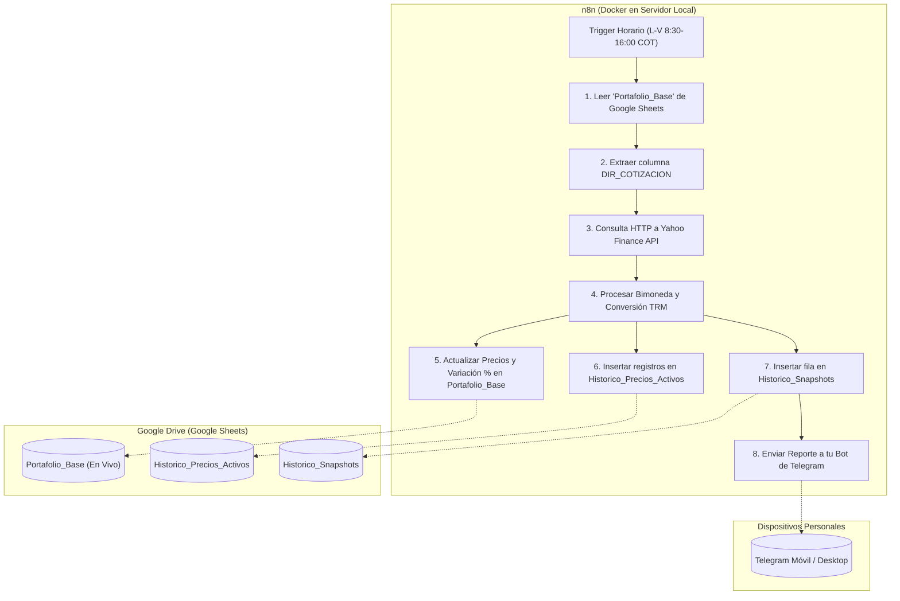

# 📈 Monitor de Portafolio Financiero Automatizado (BVC, MGC & USA)
### Sistema autónomo de ingesta de cotizaciones, consolidación patrimonial bimoneda y reportes en Telegram con n8n y Google Sheets

[](https://n8n.io)
[](https://www.docker.com/)
[](https://sheets.google.com)
[](https://telegram.org)
[](https://opensource.org/licenses/MIT)

Este proyecto proporciona una infraestructura completa, desacoplada y de código abierto para realizar **seguimiento automático de inversiones en acciones y ETFs** de la **Bolsa de Valores de Colombia (BVC)**, el **Mercado Global Colombiano (MGC)** y la **Bolsa de Nueva York / NASDAQ (USA - Dólares)**, compatible con plataformas como **Trii**, comisionistas de bolsa o brokers locales.

---

## 🚀 Características Principales

* 🧠 **Arquitectura Guiada por Datos (Data-Driven):** El motor no tiene tickers quemados en código. Lee tu hoja de Google Sheets al inicio de cada ciclo y procesa dinámicamente cualquier activo nuevo que agregues.
* 💵 **Soporte Bimoneda Nativo (COP y USD):** Consulta activos en pesos colombianos y en dólares estadounidenses, unificando el patrimonio total mediante la **TRM oficial en tiempo real** (`GOOGLEFINANCE("CURRENCY:USDCOP")`).
* 📊 **Doble Nivel Histórico:**
  * **Macro:** Registro congelado (Snapshot) de la evolución de tu patrimonio total por hora/fecha.
  * **Micro:** Auditoría ticker por ticker con precio de apertura, cierre previo, variación del día ($ y %) y volumen.
* 💬 **Alertas Ejecutivas en Telegram:** Notificaciones directas a tu chat privado cada hora de mercado con el patrimonio total, rentabilidad consolidada, y las mayores subidas y caídas de la jornada.
* 🔒 **100% Privado y Seguro:** Corre en tu propia máquina o servidor local mediante Docker. Tus saldos y credenciales nunca salen de tu control.
* 🔋 **Bajo Consumo:** Diseñado para funcionar 24/7 en cualquier portátil con la tapa cerrada, Mini PC o servidor casero Linux.

---

## 🏗️ Arquitectura del Sistema



---

## 📁 Estructura del Repositorio

```text
MonitorPortafolio/
├── docker-compose.yml                     # Despliegue de n8n autocontenido
├── .env.example                           # Variables de entorno opcionales
├── .gitignore                             # Protección de claves y temporales
├── templates/
│   ├── Plantilla_Monitoreo_Portafolio.xlsx # Plantilla Excel preconfigurada con fórmulas
│   └── prompt_creacion_google_sheets.md    # Prompt maestro para Gemini / ChatGPT
├── workflows/
│   └── wf-monitoreo-portafolio.json       # Workflow listo para importar en n8n
└── README.md                              # Guía de despliegue completa
```

---

## 🛠️ Guía Rápida de Despliegue en 5 Pasos

### Paso 1: Crear tu Hoja de Cálculo en Google Drive
Tienes dos opciones fáciles y seguras:

* **Opción A (Recomendada - 30 segundos):**
  1. Ve a tu [Google Drive](https://drive.google.com).
  2. Haz clic en **Nuevo > Subir archivo** y selecciona el archivo [`templates/Plantilla_Monitoreo_Portafolio.xlsx`](./templates/Plantilla_Monitoreo_Portafolio.xlsx) incluido en este repositorio.
  3. Haz clic derecho sobre el archivo subido y selecciona **Abrir con > Hojas de cálculo de Google**.
  4. Guarda el archivo como Hoja de cálculo de Google.
  5. Copia el **ID de tu Google Sheet** de la URL del navegador:
     ```text
     https://docs.google.com/spreadsheets/d/1aBcDeFgHiJkLmNoPqRsTuVwXyZ/edit
                                            ^^^^^^^^^^^^^^^^^^^^^^^^^^^^^^
                                            Este es tu ID de Google Sheet
     ```

* **Opción B (Con IA):**
  Copia el contenido de [`templates/prompt_creacion_google_sheets.md`](./templates/prompt_creacion_google_sheets.md) y pégalo en Gemini o ChatGPT para que genere el libro.

---

### Paso 2: Crear Credencial de Google Sheets (OAuth 2.0)
1. Ve a [Google Cloud Console](https://console.cloud.google.com) y crea un proyecto (ej. `Monitor-Portafolio`).
2. En el menú lateral ve a **APIs y servicios > Pantalla de consentimiento de OAuth**:
   * Selecciona **Externo**.
   * Ingresa tu correo como asistencia y desarrollador.
   * En la sección **Usuarios de prueba**, agrega tu propio correo de Gmail.
3. Ve a **APIs y servicios > Biblioteca**, busca y habilita:
   * **Google Sheets API**
   * **Google Drive API**
4. Ve a **Credenciales > Crear credenciales > ID de cliente de OAuth**:
   * Tipo de aplicación: **Aplicación web**.
   * Nombre: `n8n-oauth`.
   * URIs de redireccionamiento autorizados:
     `http://localhost:5678/rest/oauth2-credential/callback`
5. Guarda tu **Client ID** y **Client Secret**.

---

### Paso 3: Crear tu Bot de Telegram
1. Abre Telegram y busca al usuario verificado **`@BotFather`**.
2. Envía el comando `/newbot` y sigue las instrucciones para asignarle un nombre y un usuario (debe terminar en `bot`).
3. Guarda el **HTTP API Token** proporcionado.
4. Abre un chat con tu nuevo bot en Telegram y haz clic en **Iniciar** (o envíale `/start`).
5. Abre en tu navegador la URL:
   `https://api.telegram.org/botTU_TOKEN_AQUI/getUpdates`
   Busca `"chat":{"id": 123456789}` para obtener tu **Chat ID numérico**.
6. En BotFather ejecuta `/setjoingroups` > Selecciona tu bot > **Disable** (para blindarlo de grupos extraños).

---

### Paso 4: Iniciar n8n con Docker Compose
1. Clona este repositorio o copia los archivos en tu máquina/servidor:
   ```bash
   git clone https://github.com/tu-usuario/MonitorPortafolio.git
   cd MonitorPortafolio
   ```
2. Inicia el contenedor en segundo plano:
   ```bash
   docker compose up -d
   ```
3. Abre tu navegador en:
   ```text
   http://localhost:5678
   ```
4. Crea tu usuario administrador la primera vez que ingreses.

---

### Paso 5: Importar y Activar el Workflow en n8n
1. En n8n, ve a **Credentials > Add Credential**:
   * **Google Sheets OAuth2 API:** Pega tu Client ID y Client Secret, y haz clic en *Sign in with Google*.
   * **Telegram API:** Pega tu Access Token de BotFather.
2. Ve a **Workflows > + Add workflow > Menú ⋯ > Import from File**:
   * Selecciona el archivo [`workflows/wf-monitoreo-portafolio.json`](./workflows/wf-monitoreo-portafolio.json).
3. Configura tus datos en el flujo:
   * En los nodos de Google Sheets, reemplaza `TU_GOOGLE_SHEET_ID_AQUI` por el ID de tu hoja copiado en el Paso 1, y selecciona tu credencial de Google.
   * En el nodo `Formatear Mensaje Telegram`, coloca tu Chat ID en `chatId: 'TU_TELEGRAM_CHAT_ID_AQUI'`.
   * En el nodo `Enviar Alerta Telegram`, selecciona tu credencial de Telegram.
4. Haz clic en **Test workflow** para comprobar que todo ejecute en verde.
5. Cambia el interruptor superior a **Active**.

¡Tu sistema ya estará monitoreando tus activos y enviándote alertas cada hora! 🎉

---

## 💻 ¿Cómo agregar o modificar acciones?

Gracias a la columna **`DIR_COTIZACION`**, nunca tendrás que tocar código en n8n para agregar compras:

1. Abre tu hoja en Google Sheets en la pestaña **`Portafolio_Base`**.
2. Agrega una nueva fila:
   * **Ticker:** Símbolo local (ej. `NU`, `ECOPETROL`, `AAPL`).
   * **DIR_COTIZACION:** Símbolo exacto de Yahoo Finance:
     * Para acciones BVC / MGC en pesos: Terminan en `.CL` (ej: `ECOPETROL.CL`, `CIBEST.CL`, `AMDVASCCO.CL`, `NVDACO.CL`).
     * Para acciones de Wall Street en dólares: El ticker puro (ej: `NU`, `ACON`, `AAPL`, `MSFT`).
   * **Moneda:** `COP` o `USD`.
   * **Cantidad** y **Precio Promedio Compra**.
3. En la siguiente hora, n8n detectará la nueva acción automáticamente, consultará su cotización y la incorporará en tu patrimonio consolidado y reporte de Telegram.

---

## 🐧 Configurar una Laptop Linux para Servidor 24/7 (Capa Cerrada)

Si deseas dejar un computador portátil viejo funcionando silenciosamente en un rincón con la pantalla apagada:

1. Abre la terminal en Linux Mint / Ubuntu:
   ```bash
   sudo nano /etc/systemd/logind.conf
   ```
2. Modifica la siguiente línea:
   ```ini
   HandleLidSwitch=ignore
   HandleLidSwitchExternalPower=ignore
   ```
3. Guarda (`Ctrl + O`, `Enter`, `Ctrl + X`) y aplica:
   ```bash
   sudo systemctl restart systemd-logind
   ```
El portátil funcionará como un servidor casero con un consumo de apenas 10W a 15W al mes.

---

## 📄 Licencia

Distribuido bajo la Licencia MIT. Consulta `LICENSE` para más información.
